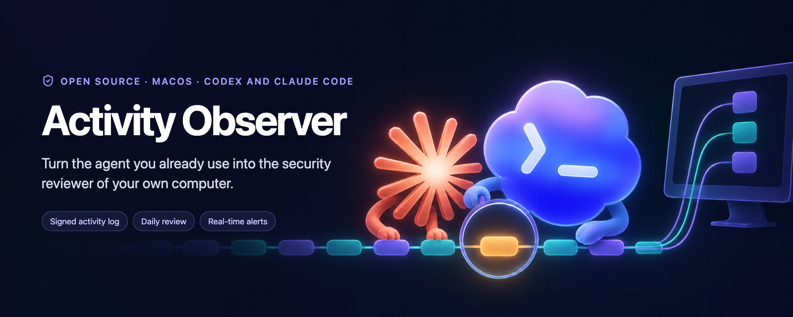
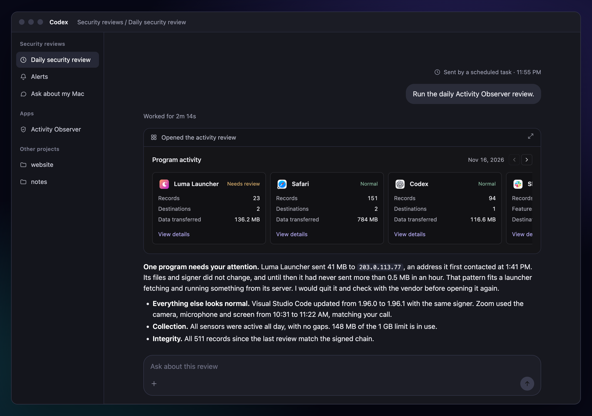
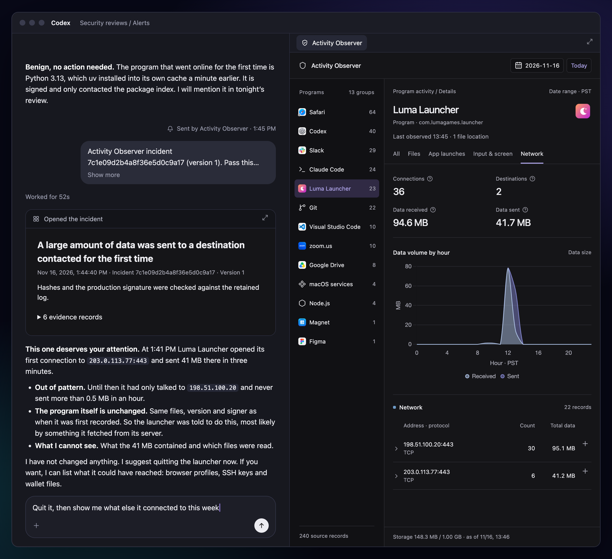
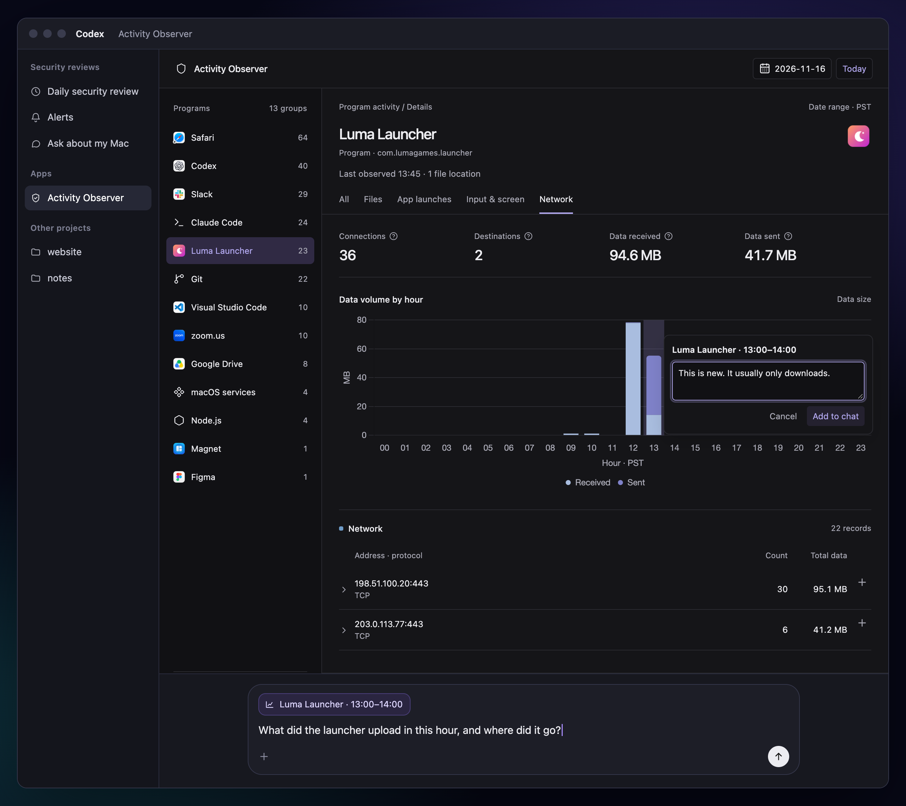
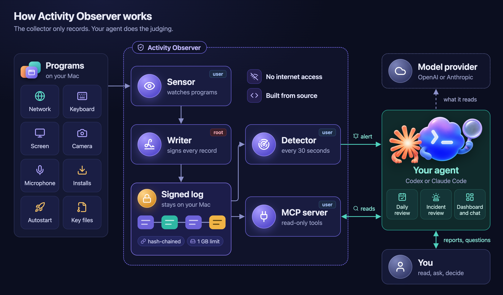

<p align="center">
  
</p>

# Activity Observer

**Turn the agent you already use into the security reviewer of your own computer.**

Activity Observer records what every program on your Mac does: what it connects to and how much it sends, when it touches the keyboard, screen, microphone or camera, what gets installed, updated or set to start automatically. It keeps that record in a signed local log and hands it to Codex or Claude Code. The agent reviews it once a day, looks into unusual activity within about a minute, and answers your questions about it in the chat you already use.

The collector does not judge and does not block. It is small, has no network access and can be read in an afternoon. The judgment comes from the agent.

> This is a first demo of the idea, for macOS. It is meant to be read, forked and adapted. See [Status](#status-and-roadmap) and [Limits](#limits) before you rely on it.

## Why now

Personal computers have become the way in.

| When | What happened |
| --- | --- |
| Sep–Nov 2026 | **NIKKE PC launcher.** Four scripts that the launcher downloads were tampered with on September 27, and from October 30 the genuine launcher fetched and ran remote-access and data-stealing malware. The attackers abused the launcher's server-side operations channel. How they got that access is not public. Nothing installed on the PC was modified. Collection and exfiltration took an estimated 6 to 10 minutes. [Announcement](https://nikke.gg/official-announcement-pc-launcher-security-incident) · [Bitdefender](https://www.bitdefender.com/en-gb/blog/labs/nikke-game-launcher-malware) · [BleepingComputer](https://www.bleepingcomputer.com/news/security/nikke-pc-game-launcher-hacked-to-spread-remote-access-data-stealing-malware/) |
| Jun–Oct 2026 | **Binance, about $6.3 billion.** The intrusion ran through employee computers: a tampered Homebrew package that an engineer installed in June while looking for an AI coding tool, a fake job-interview coding task in September, then on October 20 an internal AI tool used to reach a wallet engineer's system. The funds were taken on October 29. [Binance](https://www.binance.com/en/blog/community/3229153443759566763) · [CoinDesk](https://www.coindesk.com/business/2026/11/03/binance-s-usd6-3-billion-hack-began-with-a-fake-job-interview-exchange-says) · [Reuters](https://www.investing.com/news/economy-news/binance-says-hackers-used-fake-job-interview-to-compromise-computer-before-63-billion-attack-4995603) |
| Oct 2026 | **Tampered Claude Code extension on the Cursor marketplace.** Tampered versions 2.1.312 and 2.1.313 were distributed for about 11 hours on October 29 and tried to install an SSH backdoor. Up to 5,000 users may have been affected. [Microsoft](https://www.microsoft.com/en-us/security/blog/2026/10/30/inside-malicious-claude-code-branded-cursor-extension-persistent-ssh-backdoor/) · [Reuters](https://www.reuters.com/business/media-telecom/cursor-says-up-5000-users-affected-by-tampered-claude-code-extension-2026-10-30/) |

**AI is behind this, and it will get worse.** AI-assisted hacking has made supply-chain attacks easy, so a program from a vendor you have trusted for years can no longer be trusted by default. It has also made zero-day attacks more common, because finding a flaw and turning it into a working exploit now takes far less skill and time. Google's threat intelligence group counted 141 exploited vulnerabilities in the first eight months of 2026, more than in all of 2025, and documented a zero-day exploit it believes was developed with AI. Anthropic disrupted an espionage campaign in which an AI agent carried out 80 to 90 percent of the intrusion work. [GTIG trends](https://cloud.google.com/blog/topics/threat-intelligence/vulnerability-discovery-and-exploitation-trends-in-the-ai-era) · [GTIG, AI-built exploit](https://cloud.google.com/blog/topics/threat-intelligence/ai-vulnerability-exploitation-initial-access) · [Anthropic](https://www.anthropic.com/news/disrupting-AI-espionage)

**Security software is part of the attack surface.** It runs with high privileges, updates itself and is trusted by default.

| When | What happened |
| --- | --- |
| Jan 2026 | eScan's update server was breached and pushed a malicious update for about two hours. [BleepingComputer](https://www.bleepingcomputer.com/news/security/escan-confirms-update-server-breached-to-push-malicious-update/) · [Morphisec](https://www.morphisec.com/blog/critical-escan-threat-bulletin/) |
| Mar 2026 | The Trivy scanner's binaries and GitHub Action, then the Checkmarx KICS GitHub Action, were tampered with to steal credentials. [Microsoft](https://www.microsoft.com/en-us/security/blog/2026/03/24/detecting-investigating-defending-against-trivy-supply-chain-compromise/) · [Wiz](https://www.wiz.io/blog/teampcp-attack-kics-github-action) |
| May 2026 | An authentication bypass in Fortinet FortiClient EMS let attackers use the management channel to push an infostealer disguised as a Fortinet update. [BleepingComputer](https://www.bleepingcomputer.com/news/security/hackers-exploit-forticlient-ems-flaw-to-push-infostealer-malware/) |
| Jun 2026 | An authentication bypass in Palo Alto GlobalProtect was exploited in the wild. [Unit 42](https://unit42.paloaltonetworks.com/active-exploitation-of-pan-os-cve-2026-0257/) |

## The idea

Traditional security software decides with signatures and rules that a vendor ships. A new technique passes until the vendor catches up, a harmless program is sometimes blocked, and the product that makes these decisions is heavy, privileged and updated from outside.

Meanwhile a capable security analyst is already installed on many computers: the coding agent. It can read a week of activity, notice that a launcher which never uploaded anything just sent 40 MB to an address it first contacted two minutes ago, check what changed in that program beforehand, and explain it in plain language. People have already caught [an intrusion](https://stratechery.com/2026/apple-and-a-hackers-future/) and [a crypto miner](https://www.tomshardware.com/tech-industry/cryptomining/claude-code-ai-agent-caught-a-crypto-miner-hiding-on-a-developers-overheating-mac-xmrig-task-was-hogging-about-1175-percent-cpu-roughly-12-cores-pushing-temps-to-112-degrees) this way.

What the agent lacks is eyes. It only sees what you paste into the chat. Activity Observer gives it a continuous, tamper-evident record of what programs do, and a routine for reviewing it. Detection and judgment are delegated to the agent. The local part stays small enough to audit.

## What you get

### A daily review in your chat

Once a day the agent verifies the log, reads a digest of everything since the last review, judges each program and reports. The report comes with an inline widget where you can open any program and see its timeline.

<p align="center"></p>

### Real-time alerts, investigated

A detector checks new records every 30 seconds. When a program does something unusual, the incident is sent to your agent session. The agent looks at the evidence and its context and tells you what happened and whether it matters. Most alerts are benign, and the agent says so.

<p align="center"></p>

### A dashboard you can ask about

In Codex the dashboard also opens as a side-panel app: live activity, any date range, per-program timelines. Select a stretch of the chart or a single record and it is attached to your next message.

<p align="center"></p>

### Light enough to forget

The collector is built to stay out of the way of your work. Measured on an Apple M4 Mac during an active working session:

| | Measured |
| --- | --- |
| Always on: sensor, writer, system-log reader and local MCP server | about 1.1% of one CPU core, about 100 MB of memory |
| Detector: one short run every 30 seconds | about 0.5% of one core averaged over time, up to 56 MB while a run lasts |
| Daily review: building the digest of 173,000 records | 18.5 seconds, 145 MB at peak |
| Verifying the whole log: 408,000 records | 26 seconds |

The log never grows past 1 GB. The collector does not hook other programs or sit in the path of your network traffic.

### A small trusted base

The tool that watches your computer must not become the next way in.

- **No network access.** The collector, the detector and the local MCP server run under macOS sandbox profiles that deny every internet socket. They talk to each other over a Unix socket and loopback only.
- **No updater, no telemetry, no downloaded rule sets.** What you build is what runs until you build again.
- **Source only.** There are no binary releases. `./setup.sh` compiles the collector on your Mac, pins the SHA-256 of every installed file and refuses to run anything that differs.
- **A signed log.** Records are hash-chained and signed by a root-owned writer. A program running as your user cannot rewrite history without detection.
- **Read-only tools.** The agent can query and display. It cannot block, delete or reconfigure through Activity Observer.

Details and verification steps: [docs/TRUST.md](docs/TRUST.md).

## How it works

<p align="center"></p>

1. A **sensor** in your login session watches network flows, input and screen access, audio and camera use, privacy permission decisions, app launches, program files and a short list of sensitive files.
2. A root-owned **writer** is the only process that can append to the log. It hash-chains every record, signs the head and enforces a 1 GB storage limit by pruning the oldest records.
3. A **detector** reads new records every 30 seconds and applies a small set of [rules](docs/DETECTION.md). A match becomes an incident and is delivered to your agent session.
4. A local **MCP server** gives the agent read-only tools and renders the dashboard and report widgets as [MCP Apps](https://modelcontextprotocol.io).
5. The **plugin** for Codex and Claude Code adds three skills: setup, daily review and incident review.

## Install

Requirements: macOS 14.2 or later, the Xcode command line tools, Node.js 22 or later, and Codex or Claude Code.

```sh
git clone https://github.com/jin-su-choi/activity-observer.git
cd activity-observer
./setup.sh
```

The script builds and tests the collector, asks once for the administrator password to install it, and registers the plugin with the agents it finds. Then open your agent in the folder where security reviews should live and say:

> Set up Activity Observer.

The agent points real-time alerts at that chat, schedules the daily review with its own scheduling feature and runs the first review.

**Read it before you run it.** This project asks for administrator rights and watches your computer. Have your agent audit the checkout first:

> Review this repository before I install it. Look for anything that opens a network connection, writes outside its own directories, runs with root privileges without need, or does something the README does not describe. List what you checked.

To remove it: `./uninstall.sh` keeps the log and its key, `./uninstall.sh --purge` deletes everything.

## What is recorded

| Recorded | Not recorded |
| --- | --- |
| Connections per program: remote address and port, protocol, bytes sent and received, the chain of parent programs | Packet contents, domain names, URLs |
| Keyboard event taps and HID device access | Keystrokes |
| Screen capture, camera and microphone use | Screen images, audio, video |
| Privacy permission decisions (which program, which permission, allowed or denied) | |
| Programs installed, updated, removed, first seen; signer and version | File contents |
| Autostart items (LaunchAgents, LaunchDaemons, privileged helpers) | |
| Changes to SSH access, shell startup files, credential routing and agent settings, as hashes | The contents of those files |
| App launches and exits | Every process start (see [Limits](#limits)) |

Full list: [docs/PRIVACY.md](docs/PRIVACY.md).

## Limits

Read these before you treat a quiet day as a safe day. The complete list is in [docs/KNOWN_LIMITS.md](docs/KNOWN_LIMITS.md).

- **It observes. It does not prevent.** A fast information stealer can finish before anyone reacts. The value is knowing quickly, knowing what was touched and having a record that survives.
- **Real time is gated by fixed rules.** Only incidents that match a rule reach the agent within a minute. The agent sees everything else at the daily review. The rules are few and need to keep improving, and the repository includes a tool to replay them against your own log.
- **Not everything is visible.** A process that never uses the network or a watched location, files read from inside a running interpreter, and small uploads to a familiar destination all go unseen. Process starts in the terminal are not recorded yet.
- **Root is the boundary.** The signing key lives on the same Mac. After a root compromise the log can no longer be trusted. The detector, the MCP server and the plugins run as your user, and malware running as your user can stop or mislead them.
- **Your activity data reaches the model provider.** Whatever the agent reads to do a review is sent to OpenAI or Anthropic like the rest of the chat. The agent itself is a program that updates automatically.
- **macOS only today.** Windows support is planned. The side-panel dashboard needs Codex. Claude Code gets the skills, the tools and the inline widgets.

## Related projects

- [Hashling](https://github.com/0xArx/hashling) pursues the same goal, an AI security engineer for your Mac, with a signed installer, its own web dashboard, a built-in assistant and online lookups.
- [MacCrab](https://github.com/peterhanily/maccrab) is a full detection engine on Endpoint Security with hundreds of rules, MCP tools and daily updates.
- [TaskExplorer](https://objective-see.org/products/taskexplorer.html), [osquery MCP servers](https://github.com/kousen/OsqueryMcpServer) and agent-activity monitors such as [RawTrail](https://github.com/RawTrail/RawTrail) cover neighboring ground.

Activity Observer differs in two ways. The whole loop, daily review, alert, dashboard and questions, happens inside the agent chat you already use. And the part you have to trust is deliberately small: no network access at all, no updater, no downloaded lists, source builds only, a signed log.

## Status and roadmap

Version 0.4.0. It runs daily on the author's Mac. The fresh-install path, Claude Code and other macOS versions have had far less testing than that one machine. [docs/KNOWN_LIMITS.md](docs/KNOWN_LIMITS.md) says exactly what was verified.

Planned: Windows support, recording process starts, destination names next to addresses, and more detection rules shaped by replays of real logs.

## Maintenance

Changes to this repository are kept to a minimum on purpose, because every change is something you would have to review again. Only the owner can merge into `main`, releases are signed tags, and there is no automatic update. If you need something different, fork it and change your copy. See [CONTRIBUTING.md](CONTRIBUTING.md) and [SECURITY.md](SECURITY.md).

## License

[MIT](LICENSE)

Codex and Claude are trademarks of OpenAI and Anthropic. Activity Observer is an independent project and is not affiliated with or endorsed by either company.
